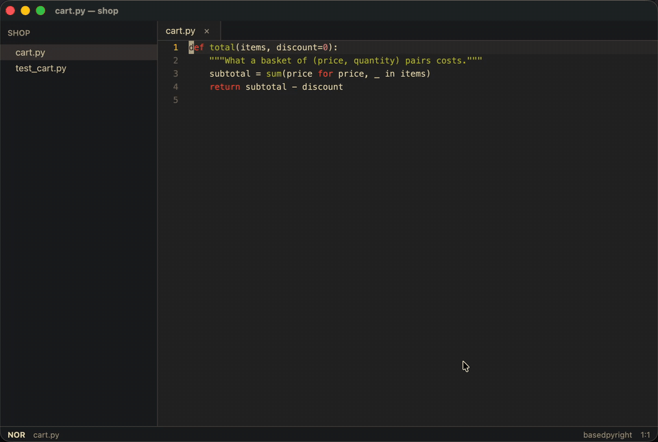

# Ghostwrite

**Take back control of your code, without sacrificing speed.**



With most AI coding tools you either let the agent write it all and review a large diff
afterwards, or you spell out every detail yourself. Ghostwrite lets you review as you go:
the model proposes one step at a time, right where it goes, and you accept it with Tab or
redirect it with Enter. You understand every change as it's made, and it's as quick as
autocomplete.

Ghostwrite is a fast modal editor in the helix tradition, for macOS, Windows and Linux.
Every language is a sandboxed WebAssembly plugin.

## Install

**macOS:** download the DMG from the
[latest release](https://github.com/ghostwrite-dev/ghostwrite/releases/latest) and drag
Ghostwrite to Applications. It isn't notarized yet, so the first time, right-click it and
choose **Open**.

**From source:**

```sh
./install.sh                    # macOS: installs /Applications/Ghostwrite.app
scripts/install-linux.sh        # Linux: installs ~/.local/bin/ghostwrite and a desktop entry
scripts/install-windows.ps1     # Windows: installs for this user, with a Start menu entry
```

Building needs Rust 1.97 and `cmake`; on macOS the Metal toolchain, on Linux the packages
named at the top of its script, and on Windows the MSVC toolchain and LLVM. See
[Install](https://ghostwrite-dev.github.io/ghostwrite/install.html).

**Plugins:** thirteen come with the app. Typst and Lean are installed from the editor:

```text
:plugin install ghostwrite-dev/typst
:plugin install ghostwrite-dev/lean
```

Each asks first, listing what the plugin adds and can reach; Enter installs it.

## Getting started

- Open a folder with ⌘⇧O, or `ghostwrite ~/code/thing`. `:tutor` teaches the keys.
- `space ?` shows every key. To move around, `space e`, `space t` and `space x` go to Files,
  the terminal and the debugger, and plugins' views have keys of their own (`space v` for
  Typst's pages, `space g` for Lean's goals); the same key goes back.
- Connect a model: `:api-key ‹key›` for the Anthropic API, or Claude Code if it's installed.
  `:model` lists what can be asked, local models included, and `:model ‹name›` chooses.
- `space a` asks about the line or selection. Tab accepts a step, Enter redirects, and
  Esc Esc stops, keeping what you accepted.

## Documentation

The docs are at [ghostwrite-dev.github.io/ghostwrite](https://ghostwrite-dev.github.io/ghostwrite/):

- [Getting started](https://ghostwrite-dev.github.io/ghostwrite/getting-started.html)
- [Key reference](https://ghostwrite-dev.github.io/ghostwrite/keys/index.html)
- [Asking and reviewing](https://ghostwrite-dev.github.io/ghostwrite/stories/reviewing.html)
- [Models and backends](https://ghostwrite-dev.github.io/ghostwrite/models/index.html)
- [Plugins](https://ghostwrite-dev.github.io/ghostwrite/plugins/index.html)
- [Writing plugins](https://ghostwrite-dev.github.io/ghostwrite/writing-plugins/index.html)

## Contributing

See [CONTRIBUTING.md](CONTRIBUTING.md), and run `./check.sh` before you commit.

## License

The Mozilla Public License 2.0: see [LICENSE](LICENSE). The word motions in
`crates/core/src/movement.rs` are ported from helix, under the same license.
