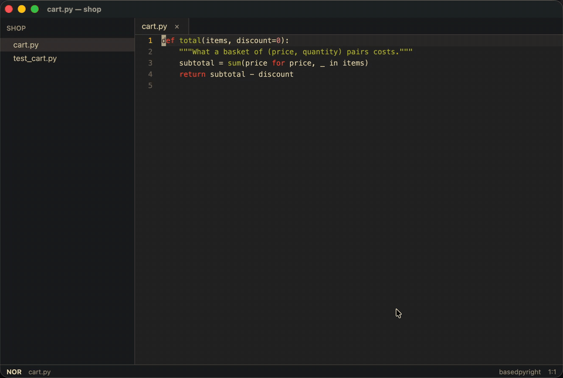

# Ghostwrite

**Take back control of your code, without sacrificing speed.**

Ghostwrite is a modal editor for macOS, Windows and Linux. Its keys are helix's, it's built on [gpui](https://www.gpui.rs), and it has a language model in it that works one step at a time.

With an AI agent, you review its work afterwards, as one large diff. In a plain editor, you write every detail yourself. In Ghostwrite you review as you go: each change comes as one small step, and you decide it before the next one comes.

## How it works

Point at some lines with `space a` and say what you want. A question is answered with notes pinned to the code, across files. A change comes as small, whole-line steps, the next one shown as ghost text where it goes. Press Tab to accept it, like autocomplete, and the next step comes. If it's not what you want, press Enter and say so: the model takes that into account for what comes next. A step can also be a command to run in your terminal (a build, the tests), and the model sees what it printed. Nothing changes until you accept it.

That exchange is a *story*. While one is up you can still move around, open files and scroll. A step that arrives meanwhile waits in the corner, and the next Tab brings you back to it.

## What's in it

- **A helix-style modal editor.** Select first, then act. Multiple cursors, text objects from the syntax tree, registers, macros, splits, a file tree and fuzzy pickers. `space ?` shows every key.
- **Stepwise AI stories.** Through the Anthropic API, Claude Code, or a local model run by llama.cpp inside the app.
- **A built-in terminal.** Your own shell, under the code. You can read it with the editor's keys, and the model can run commands in it, but only the ones you accept.
- **Language servers and a debugger.** Go to definition, references, rename, code actions, diagnostics, formatting, and stepping through a program with any debug adapter.
- **Plugins for everything.** Built in, Ghostwrite knows only plain text. Every language, and PDFs and images, comes as a sandboxed WebAssembly plugin. You can install more, or write your own.

## Where to go next

- [Install](install.md) Ghostwrite.
- [Getting started](getting-started.md) takes five minutes.
- [AI stories](stories/README.md) explains the review loop in full.
- [Writing plugins](writing-plugins/README.md) is for adding a language or a feature.
